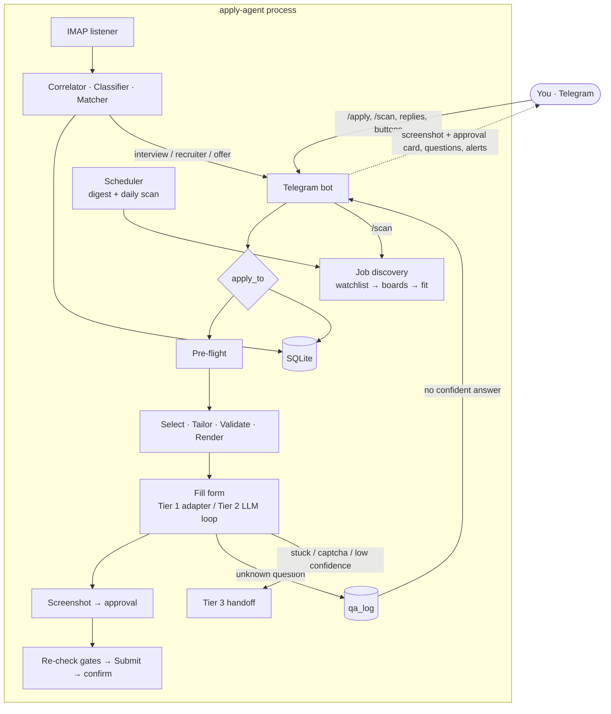

# Architecture

## Process layout

`apply-agent` is one Python process with one asyncio event loop. Subsystems without credentials switch themselves off with a startup warning; the rest keeps running.



## One application

```
/apply <url>                     (Telegram, CLI --apply, or 🚀 on a discovered job)
 │  serialised: one application at a time (one browser profile; exact daily cap)
 ├─ detect ATS from the hostname → tier1 | tier2 | tier3 (LinkedIn → manual only)
 ├─ refuse if live without Telegram, or this URL was already submitted
 ├─ open browser → parse the posting (adapter DOM, or page text + Gemini extract)
 ├─ pre-flight: window · daily cap · cooldown · H1B sponsor (if you need one)
 │              · salary floor · Gemini quota headroom
 ├─ select resume variant (role routing + local embeddings), skipping example files
 ├─ tailor with Gemini → validator; 2 attempts with feedback, else stop + tell you
 ├─ render md → docx → pdf (LibreOffice, isolated profile, verified, UUID in metadata)
 ├─ upsert the applications row (status=tailored)
 ├─ FILL (never submits):
 │    Tier 1 adapter: fixed selectors + question groups
 │    Tier 2 loop:    Gemini picks one JSON action per step; submit clicks,
 │                    foreign uploads and off-site navigation are refused in code
 │    unknown question → profile answer → qa_log (sensitive: exact match only)
 │                     → ask you on Telegram (stuck clock paused) → remember it
 ├─ screenshot the filled form → approval card (diffs, fit, missing keywords)
 ├─ dry run → stop here (status=tailored)
 └─ live → re-check window + cap → click Submit → wait for a confirmation page
          → submitted | submit_unverified (you're told to check)
 anything stuck / low-confidence → Tier 3: browser stays open, wait for /done or /abort
```

## One email

```
IMAP listener (worker thread) → on_message (main loop)
 ├─ already logged? skip
 ├─ open sign-up expectation? sender domain + DKIM + link host must match → fulfil
 ├─ classify (Gemini, or keyword rules when unavailable)
 ├─ match to an application (sender domain = company, or company name as a word)
 ├─ log; move the application forward (response / interview / offer / rejected)
 └─ interview / recruiter / offer → Telegram alert
 failure → message stays unread, retried up to 3 times
```

## Modules

```
src/
├── main.py              CLI + daemon wiring
├── config.py            env vars, paths, guardrails (single place that reads os.environ)
├── doctor.py            --doctor setup checks
├── orchestrator/        pipeline.py (apply_to), preflight.py
├── ats/                 base.py (fill/submit contract), common.py (shared DOM helpers),
│                        fields.py (question classifier + polarity-correct answers),
│                        detector.py, greenhouse/lever/ashby/workable/smartrecruiters.py,
│                        llm_fallback.py (Tier-2 task)
├── execution/           tier2_browseruse.py (LLM loop), tier3_handoff.py
├── browser/             harness.py (persistent profile), fingerprint.py, handoff.py (stuck guard)
├── resume/              source, selector, embeddings, tailor, validator, renderer
├── discovery/           boards.py (public ATS feeds), fit.py, watchlist.py, scan.py
├── profile/             schema, loader (age), qa_log
├── accounts/            signup, vault (per-row age + CSV mirror), password_gen
├── llm/                 client.py (google-genai, retries), rate_limiter.py, prompts/
├── telegram_bot/        bot.py, cards.py (HTML), allowlist.py
├── email_monitor/       imap_idle, signup_correlator, classifier, matcher, handler
├── observability/       digest, rate_tracker (per-variant response rate), scheduler
├── linkedin/            referral scan + DM drafter (you send DMs yourself)
├── company_research/    page fetch + HTML → text
├── util/                time (local-day bounds), skills (shared lexicon)
└── db/                  models, session, migrations/
```

## Concurrency

- One event loop. Blocking work (LibreOffice, embeddings) runs in `asyncio.to_thread`.
- IMAP runs in a worker thread and hands each message to the main loop with `run_coroutine_threadsafe`; cancelling the listener stops the thread.
- Approvals, answers and `/done` are `asyncio.Future`s resolved by the bot's handlers. Answers are keyed by the question's message, so replies reach the right application.
- `apply_to` holds a process-wide lock.

## Where state lives

| State | Where |
|---|---|
| Encrypted profile | `secrets/profile.yaml.age` |
| Master key | `secrets/master.age.key` (back it up) |
| Portal passwords | `apply_agent.db:portal_credentials` (age per row) + `secrets/portal_passwords.csv` (0600 mirror) |
| Applications, answers, emails, discovered jobs | `apply_agent.db` (`APPLY_AGENT_DB`) |
| Tailored resumes | `data/tailored/<uuid>/<First>_<Last>_Resume.pdf` (+ docx, meta.txt) |
| Screenshots | `data/screenshots/` |
| Gemini usage today | `data/gemini_usage.json` |
| Browser profile | `chrome-profile-apply/` (`APPLY_BROWSER_PROFILE`) |
| Watchlist | `watchlist.yaml` |

`secrets/`, `data/` contents, the DB, the browser profile and `watchlist.yaml` are gitignored.
